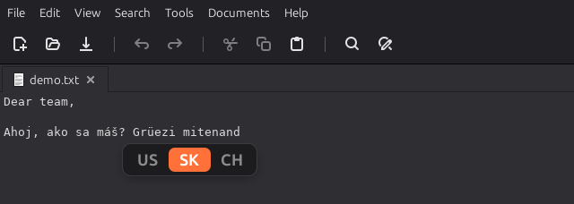

# Input Switch Popup

A Cinnamon extension for Linux Mint that shows a small popup **at your text
cursor** whenever you switch keyboard layout, the way macOS and Windows do.



## Features

- **Appears where you type.** The popup opens just below the text cursor. If
  the app doesn't report where its cursor is, it opens next to the mouse
  pointer instead.
- **Lists all your layouts.** A highlight slides from the old layout to the
  new one. With more than five layouts, the row scrolls to keep the active one
  in view.
- **Matches your theme.** The highlight uses the accent color of your Cinnamon
  theme (Mint-Y, Mint-L and their color variants) and follows theme changes.
- **Stays out of the way.** It fades out after a moment, never takes focus
  and ignores clicks.

## Requirements

- Cinnamon 6.0 or newer (tested on Linux Mint 22.3 with Cinnamon 6.6)
- `python3`, `python3-gi` and `gir1.2-atspi-2.0` for cursor tracking. These
  are installed by default on Linux Mint.

## Installation

### From Cinnamon Spices

Once published: *System Settings → Extensions → Download*, search for
**Input Switch Popup**, install it, then enable it on the *Manage* tab.

### From this repository

```bash
git clone https://github.com/JozefCulen/cinnamon-input-switch-popup.git
cd cinnamon-input-switch-popup
./install.sh
```

`install.sh` symlinks the extension into
`~/.local/share/cinnamon/extensions/` and enables it. Run it again after
pulling changes to reload the extension.

To uninstall, disable the extension in *System Settings → Extensions* and
delete `~/.local/share/cinnamon/extensions/input-switch-popup@JozefCulen`.

## Settings

*System Settings → Extensions → Input Switch Popup → Configure*:

| Setting | Default | |
|---|---|---|
| Popup position | Text caret | *Text caret* falls back to the mouse pointer; *Mouse pointer* always uses the pointer |
| Show all layouts | On | Off shows only the new layout |
| Duration | 800 ms | How long the popup stays visible |
| Font size | 18 px | |

## Which apps show the popup at the cursor?

The cursor position comes from the accessibility interface (AT-SPI), so it
depends on the app:

| Apps | Cursor position |
|---|---|
| GTK apps such as xed (tested), Text Editor, Nemo | Works out of the box |
| Firefox, LibreOffice, Qt apps | Not tested yet |
| Chrome, Chromium and Electron apps (VS Code, Slack, Discord…) | Only with accessibility enabled, see below |
| Places without a text field (desktop, file lists) | Mouse pointer |

To get the cursor position in Chromium-based apps, either start them with
`--force-renderer-accessibility`, or turn on accessibility for the whole
desktop and restart those apps:

```bash
gsettings set org.gnome.desktop.interface toolkit-accessibility true
```

So far only the `--force-renderer-accessibility` flag has been tested.
Either way, Chromium-based apps use somewhat more CPU and memory.

## How it works

- `extension.js` listens to Cinnamon's input source manager
  (`current-source-changed`) and draws the popup with St widgets in
  `Main.uiGroup`.
- `caret-helper.py` runs as a child process and tracks the focused text widget
  over AT-SPI. On each switch the extension asks it for the cursor rectangle
  and waits at most 150 ms before falling back to the pointer. Accessibility
  calls can block, so they never run inside Cinnamon itself.
- The cursor is only used if it belongs to the focused window, so a stale
  position from another app is never used.
- The accent color is read from the theme's slider fill color
  (`-slider-active-background-color`).

## Development

```text
input-switch-popup@JozefCulen/            # laid out as a Cinnamon Spices entry
├── info.json
├── README.md                             # shown on the Spices website
├── screenshot.png
└── files/input-switch-popup@JozefCulen/  # the installed extension
    ├── metadata.json
    ├── extension.js
    ├── caret-helper.py
    ├── settings-schema.json
    ├── stylesheet.css
    └── icon.png
```

- Logs and errors: `~/.xsession-errors`, or Looking Glass (`Alt+F2`, `lg`).
- Reload after editing: `./install.sh`.
- Switch layout from a shell, useful for testing:

  ```bash
  gdbus call --session --dest org.Cinnamon --object-path /org/Cinnamon --method org.Cinnamon.Eval "imports.ui.keyboardManager.getInputSourceManager().inputSources[1].activate()"
  ```

- Test the cursor helper on its own: run
  `python3 input-switch-popup@JozefCulen/files/input-switch-popup@JozefCulen/caret-helper.py`,
  click into a text field, go back to the terminal and type `q` + Enter.

## License

[MIT](LICENSE)
